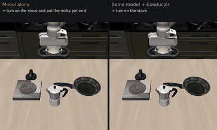
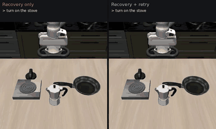

# Conductor: a harness for agentic robotics

Agentic AI wraps a model in a harness: tools, verification, retries. Conductor
does the same for robot policies. It gives a VLA one step of a task at a
time, checks that each step happened, brings the robot back to a state the
next step can start from, and retries what failed. The model is unchanged;
the harness is what you add.

## Result: LIBERO-Long

[](videos/base_vs_conductor.mp4)

*The same SmolVLA, the same task and starting scene, 2× speed. Left: the model
alone with the task's instruction. It fiddles with the stove knob without
turning it on and runs out of time. Right: inside Conductor. It is told
"turn on the stove", then the harness brings the hand back to its start pose
and says "put the moka pot on the stove"; when that stalls it recovers and
retries, and the pot lands on the stove. Then the same for the soup and
tomato sauce. Click for the full video.*

SmolVLA (450M parameters) trained on LIBERO-90's single-step tasks, on the
LIBERO-Long tasks whose steps it knows (6 of 10), 10 episodes × 3 seeds,
same 520-step budget throughout:

| | Success |
|---|---|
| The model alone, given the full instruction | 0% |
| + Conductor: one step at a time, each verified | 0% |
| + start-state check and recovery pose between steps | 56.1% |
| **+ retry a step that stalls** | **67.8%** |
| *For reference: the best end-to-end SmolVLA for LIBERO (`lerobot/smolvla_libero`)* | *43.9%* |

What each part adds:

- **Step-by-step only works with a model trained on steps in the same
  scenes.** The end-to-end SmolVLA treats the instruction as a task id and
  ignores step commands (13.7% of steps done); the LIBERO-90 one follows them
  (82.4% where LIBERO-90 has that step in that scene).
- **Handoffs are the bottleneck.** Every step works from the robot's start
  pose (50–100%) and fails right after the previous step (0%), often undoing
  it. Checking each step's start state and returning the hand there when it
  doesn't hold takes a two-step task from 0% to 56%.
- **Retries recover most of the rest.** 42% of retried steps succeed, which
  brings the chain to 67.8%, close to the 69% the steps' individual success
  rates predict.

[](videos/retry_before_after.mp4)

*What retry adds: the same episodes with recovery only (left) and with
retry (right), 2× speed. On the left the arm knocks the moka pot over and
runs out of time; on the right the stalled step is retried from the start
pose and succeeds.*

Today the steps are checked with LIBERO's own goal predicates and the step
plans are written per task. Next: a camera-based verifier, a planner that
writes the steps from the instruction, and the same harness around other
VLAs. See [PLAN.md](PLAN.md).

## How it works

```
 instruction ──► plan: [step 1, step 2, …]          (per task now; an LLM next)
                    │
       ┌────────────▼─────────────┐
       │ for each step:           │
       │  start state OK? ── no ──► recovery pose (hand home, gripper open)
       │  run the VLA on the step │
       │  verified? ── timeout ───► retry once (via the start-state check)
       │  earlier step undone? ───► go back to it
       └────────────┬─────────────┘
                    ▼ 7-d actions at 20 Hz
               LIBERO / robot
```

| Component | Code | Default |
|---|---|---|
| VLA as a skill (any LeRobot policy) | `harness/vla_skill.py` | — |
| Step plans | `harness/plans.py` | one step per goal predicate, LIBERO-90 wording |
| Start-state contract | `harness/start_state.py` | hand within 2 cm / 0.1 rad of the start pose, gripper open |
| Recovery pose | `harness/recover.py` | through the robot's own controller, ≤ 80 steps |
| Rollout loop, verifier, retry | `harness/rollout.py` | step confirmed after 5 steps; timeout 160; 1 retry |
| Switches (one per component) | `harness/config.py` | set with `$HARNESS_CONFIG` |

## Run it

Conductor runs inside LeRobot's evaluation (`lerobot-eval`), so seeding,
batching and scoring are LeRobot's own. Setup (LeRobot + LIBERO in their
own env) and the pitfalls found on the way: [libero/README.md](libero/README.md).

```bash
cd ~/experiments/lerobot
MUJOCO_GL=egl LIBERO_CONFIG_PATH=$PWD/.libero \
HARNESS_CONFIG='{"steps": true, "wording": "libero90", "recover": true, "retry": true}' \
HARNESS_LOG=harness.jsonl SUBGOAL_LOG=subgoals.jsonl \
  .env/bin/python ../franka_cube_lift/harness/eval_harness.py \
    --policy.path=Kesvill/smolvla_libero_90 --policy.n_action_steps=10 \
    --env.type=libero --env.task=libero_10 --env.task_ids='[0,2,3,4,6,7]' \
    --eval.batch_size=1 --eval.n_episodes=10 --seed=1000 \
    --eval.use_async_envs=false --policy.device=cuda --output_dir=out
python ../franka_cube_lift/libero/analyze_subgoals.py subgoals.jsonl   # per-step breakdown
```

`HARNESS_CONFIG='{}'` runs the model alone (identical to plain
`lerobot-eval`). `HARNESS_LOG` records every step switch, recovery and
retry per episode.

## Where it started: cube lift

Conductor grew out of a cube-lift project on a Franka Panda in MuJoCo, where
the harness design was worked out on skills we trained ourselves:

- **Behaviour cloning done carefully:** 100% on 200 held-out positions
  (3 seeds) after fixing a blurred gripper loss and a hidden timer in the
  expert; 95% from a camera instead of the simulator's cube position.
- **A skill library** (pick, place, push, home) behind one contract:
  parameters, preconditions, declared start states, observable success and
  failure signals.
- **Handoffs first showed up here:** pick after push 35%, push after place
  75%. Declared start states plus a recovery pose took both to ≥ 98%,
  the same fix that works for the VLA above.
- **Clutter:** single-object skills fail or knock other objects over when
  something sits on their target, and never report it, which is why the
  harness's verifier has to check every object.

[](videos/loop_recover.mp4)

*Pick → place → push → pick with start-state checks and recovery, 2× speed.*

Full write-up (versions, benchmarks, perception, evaluation, setup):
[docs/cube_lift.md](docs/cube_lift.md). Skill contract: [SKILLS.md](SKILLS.md).

## Layout

```
harness/   Conductor: VLA skill, plans, start-state contract, recovery, rollout loop
libero/    LIBERO setup, eval scripts, per-subgoal logging and analysis, video scripts
results/   all benchmark results (cube: benchmark.tsv, episodes/; LIBERO: libero/)
scripts/   cube-lift env, experts, BC training, perception, skills, benchmark
models/    cube scenes (MuJoCo Menagerie based) and cube-skill checkpoints
docs/      the cube-lift write-up
videos/    README videos and previews
PLAN.md    roadmap, rules for every experiment, log of every run
```
